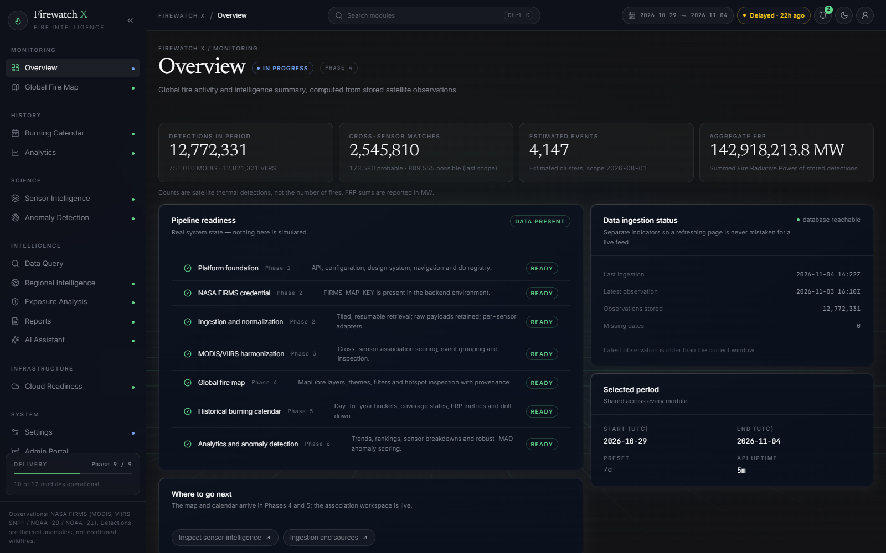
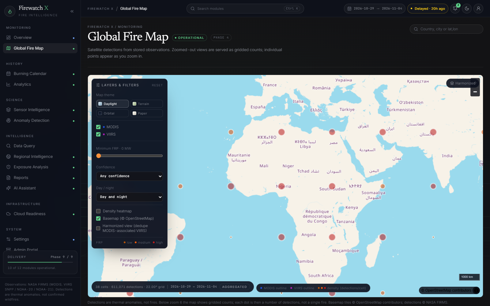
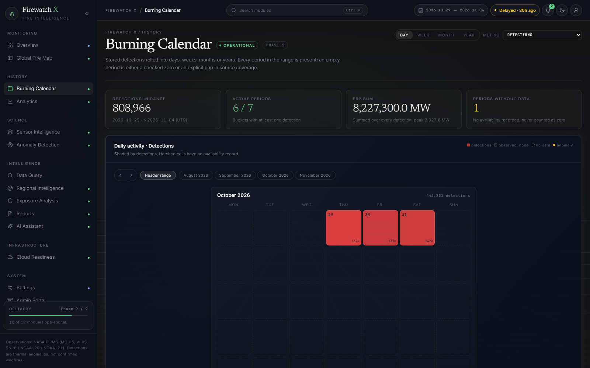
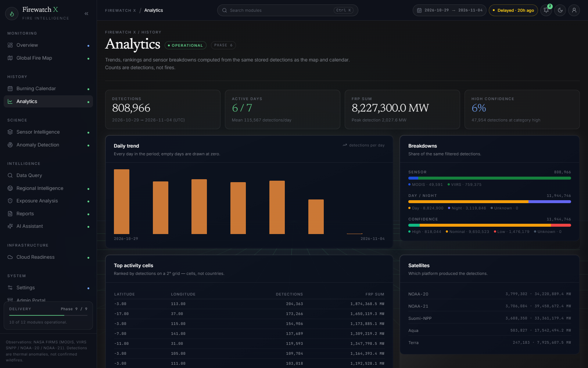
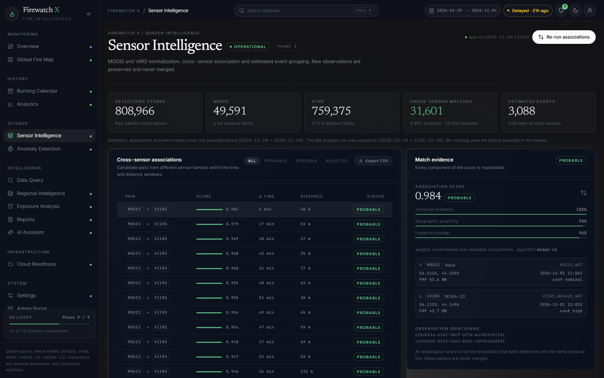
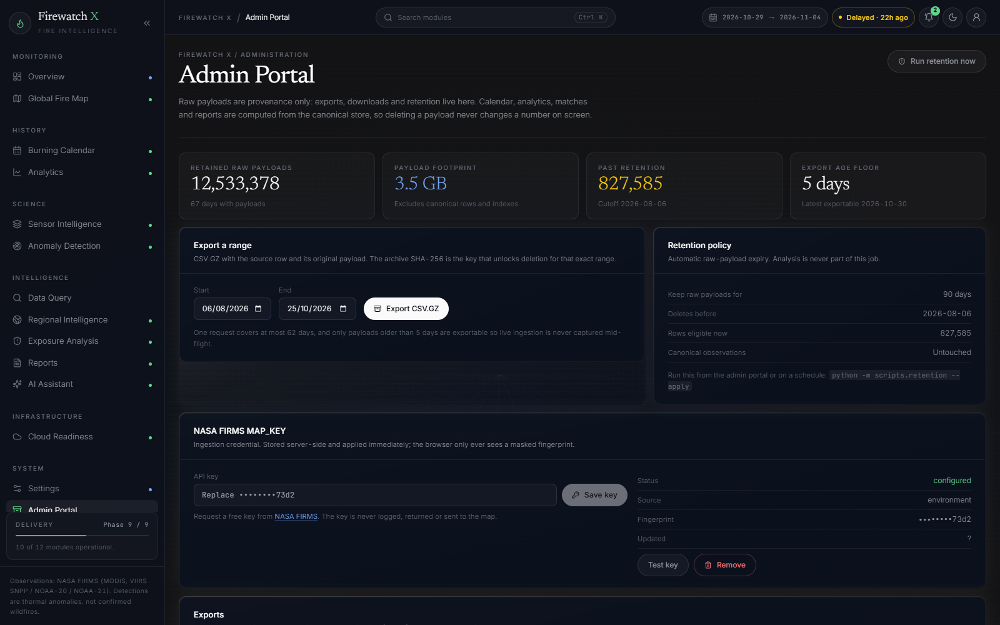
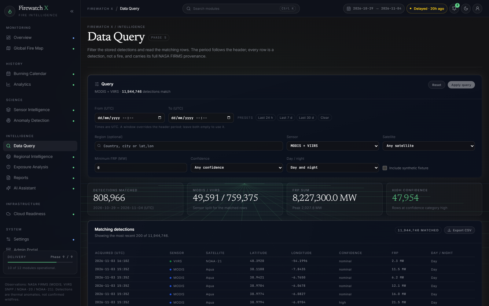

# FIREWATCH X

**Global fire intelligence, from satellite detections to defensible analysis.**

FIREWATCH X is a geospatial intelligence platform for NASA MODIS and VIIRS active-fire
observations. It retrieves real satellite thermal detections, retains the raw payloads on a 90-day
retention policy, normalises them per sensor family, associates observations across sensors, groups estimated events, and
exposes all of it through a dark analytical console.

> [!IMPORTANT]
> **Status: Phase 9 of 9 ? production ready (2026-11-04).** Ingestion, harmonization, the map,
> calendar, analytics, anomalies, query, reports, assistant, regional, exposure and the admin
> portal are delivered. Nothing on the platform is a placeholder.
>
> - **12,772,331** canonical detections in PostgreSQL (**21 GB**): NRT coverage 2026-09-02 ?
>   2026-11-03, 2026-08-01 ? 08-05 (MODIS 1?5, VIIRS 1?4), and two fixture months.
> - **12,533,378** raw payloads on hand under a **90-day** policy; older payloads are exported
>   with a SHA-256 receipt, then deleted without touching canonical analysis.
> - **234 backend / 73 frontend tests**; ruff, mypy, `tsc` and the production build pass.
> - **Known gaps:** authentication is not enforced (bind the console to localhost or a proxy),
>   there is no CI pipeline or backup/restore drill, live Cloudflare R2 upload is unexercised,
>   burned-area agreement is not measured, and 2026-08-06 ? 08-31 is still unobserved.
>
> Satellite thermal anomalies are detections, not confirmed wildfires. They may be false
> positives, may be agricultural or industrial heat, and can be hidden by cloud. Do not use this
> platform as the sole basis for protecting life or property.

---

## Screenshots

These are live captures of the console on the workstation (PostgreSQL store, 2026-11-04).

### Global overview



### Global fire map



### Burning calendar



### Analytics



### Sensor intelligence (harmonization)



### Admin portal



### Data query



---

## What works today

| Area | State |
| --- | --- |
| NASA FIRMS client: area CSV, retries/backoff, `Retry-After`, key redaction, honest failure modes | Working |
| Resumable ingestion: tiles, ≤5-day windows, per-partition checkpoints, immutable raw payloads | Working |
| Normalization: separate MODIS and VIIRS adapters, preserved raw confidence and channels | Working |
| Availability: coverage-window parsing (observed vs before/after coverage, never "zero") | Working |
| Harmonization: `S = wₜT + wₛG + w_fF`, probable/possible/rejected with full evidence | Working |
| Sensor Intelligence: MODIS/VIIRS totals, matches and events scoped to the header period, with evidence | Working |
| Event grouping: spatiotemporal DBSCAN, per-event provenance and FRP aggregates | Working |
| Map: MapLibre globe, four themes, viewport aggregation, FRP/confidence/day-night filters, harmonized toggle | Working |
| Calendar: day/week/month/year buckets, coverage states, drill-down to detections | Working |
| Query (Intelligence): time window, region, sensor/satellite, FRP/confidence scope | Working |
| Ingestion: single-source windows and one-click all-source runs | Working |
| Export: matches as CSV with both observations' provenance | Working |
| Analytics: daily trend, rankings, sensor/confidence/day-night breakdowns | Working |
| Anomalies: robust-z scoring, MAD → σ fallback, short-history window baseline | Working |
| APIs: `/fires`, `/fires/aggregate`, `/calendar`, `/analytics/summary`, `/anomalies` | Working |
| Console: overview aggregates, sensor-intelligence workspace, ingestion console | Working |
| Design system, shell, command palette, freshness, synthetic-data labelling | Working |
| Admin portal: FIRMS key (write-only, masked), raw-payload inventory, export and retention | Working |
| Raw payloads: 90-day retention, CSV.GZ export with SHA-256 gate before deletion | Working |
| Regions, exposure, reports, AI assistant, auth | Phase 6–8 |

Verified live: the map serves 57 gridded cells over 87,578 detections at world zoom and switches
to individual points when zoomed past level 6, with per-detection provenance on click.

Live verification on 2026-10-30: `VIIRS_SNPP_NRT` and `MODIS_NRT` ingested for Nigeria
(2.5,4.0,14.7,13.9) across 2026-10-29 → 2026-10-30; 4,100 observations in scope produced 659
candidate pairs (29 probable, 157 possible) and 587 estimated events (158 seen by both sensors).

## Documentation

- [docs/worklog.md](docs/worklog.md) — day-by-day record from day 1, with commits,
  measurements, incidents and known gaps.
- [docs/architecture.md](docs/architecture.md) — shape, layers, non-negotiables.
- [docs/methodology.md](docs/methodology.md) — normalization, harmonization, events,
  anomalies and the statistical gates.
- [docs/historical_backfill.md](docs/historical_backfill.md) and
  [docs/history_jobs.md](docs/history_jobs.md) — archive ingestion and long-running jobs.
- [docs/validation/accuracy.md](docs/validation/accuracy.md) — cross-sensor corroboration;
  [docs/validation/amazon_history_2016_2024.md](docs/validation/amazon_history_2016_2024.md)
  — the nine-year Amazon scale run and its removal.
- [docs/api.md](docs/api.md), [docs/operations.md](docs/operations.md),
  [docs/deployment.md](docs/deployment.md), [docs/performance.md](docs/performance.md),
  [docs/cloud.md](docs/cloud.md), [docs/regional.md](docs/regional.md),
  [docs/data_dictionary.md](docs/data_dictionary.md), [docs/user_guide.md](docs/user_guide.md),
  [docs/design.md](docs/design.md), [docs/delivery_report.md](docs/delivery_report.md).

## Cloud and datasets

Three deployment modes (`local`, `hybrid`, `cloud`) are pure configuration. Local and S3/R2 storage
sit behind one interface, detections export to partitioned Parquet (Zstandard), and synchronisation
verifies size and SHA-256 before recording success. See [docs/cloud.md](docs/cloud.md).

Long-running historical work is started through one function, CLI or durable job API; see
[docs/history_jobs.md](docs/history_jobs.md).

## Database

Nearly 12.8 million detections occupy 21 GB in PostgreSQL; day- and cell-level rollups keep the
dashboard interactive (analytics 0.24 s, calendar 0.05 s, report 0.17 s).

The live workstation runs **PostgreSQL 16** (21 GB for 12.77 M detections); SQLite remains the
zero-setup option for tests and CI. See [docs/operations.md](docs/operations.md) for starting
the local cluster, migrating, copying SQLite data across, backups and the 30-day storage
estimate (~7.1 GB for a full four-product day, ~3.7 GB at the observed rate).

## Quick start (local)

Prefer one click: `start.bat` brings up PostgreSQL, the API and the web app; `stop.bat`
shuts them down. See [docs/operations.md](docs/operations.md#start-and-stop).

Requires **Python 3.11+**, **[uv](https://docs.astral.sh/uv/)**, **Node 20+**.

```bash
cp .env.example .env          # then set FIRMS_MAP_KEY (backend-only secret)
python scripts/bootstrap.py   # prerequisites, migrations, source seed

# terminal 1 — API on :8200
cd backend && uv sync --group dev && uv run uvicorn app.main:app --reload --port 8200

# terminal 2 — console on :5273
cd frontend && npm install && npm run dev
```

- Console: <http://127.0.0.1:5273>
- API docs: <http://127.0.0.1:8200/api/docs>

Without a `FIRMS_MAP_KEY` the platform runs in its **unconfigured, empty state** — by design. It
never fabricates observations to look complete.

### Demo data without a key

```bash
cd backend && uv run python -m scripts.ingest_fixture --yes
```

Loads a small hand-written fixture, stored with `is_synthetic = true` and labelled "Demo data only"
everywhere it appears. Clear it with `python -m scripts.clear_synthetic`.

## Using it

1. **Settings** → *Ingestion console*: pick a product, a date window (≤5 days) and optionally a
   bounding box; run it. Partitions are recorded, so a repeat run resumes rather than duplicates.
2. **Sensor Intelligence**: totals by sensor, cross-sensor associations with score components,
   inspectable observation ids, and estimated events with extent and FRP aggregates.
3. **Global Fire Map**: pan and zoom. Zoomed-out views request gridded counts (never the whole
   dataset); past zoom 6 the map requests individual detections. Filter by sensor, minimum FRP,
   confidence and day/night; pick a theme (Daylight, Terrain, Paper, Orbital); search a country,
   city or `lat,lon`; click a detection to inspect its full provenance.
4. **Re-run associations** recomputes for the period selected in the header and records an
   `algorithm_run` with its scope and parameters.

```bash
# custom bounding-box ingestion
curl -X POST http://127.0.0.1:8200/api/v1/admin/ingestion/run \
  -H 'Content-Type: application/json' \
  -d '{"source_code":"VIIRS_SNPP_NRT","start_date":"2026-10-29","end_date":"2026-10-30",
       "bbox":"2.5,4.0,14.7,13.9"}'
```

## Configuration

| Variable | Required | Purpose |
| --- | --- | --- |
| `DATABASE_URL` | yes | PostgreSQL+PostGIS in deployments; SQLite is dev/test only |
| `FIRMS_MAP_KEY` | for data | NASA FIRMS key — **backend only**, never in the browser or this repo |
| `REDIS_URL` | for workers | Celery broker/result backend |
| `CORS_ORIGINS` | yes | Comma-separated allowed frontend origins |
| `AI_PROVIDER`, `AI_API_KEY`, `AI_MODEL` | no | Optional assistant; analytics works without an LLM |

> **Never put a real key in `.env.example`.** That file is tracked by git. Only `.env` (ignored)
> or a secret manager should hold credentials.

Request a free key: <https://firms.modaps.eosdis.nasa.gov/api/map_key/>

## Tests

```bash
cd backend  && uv run pytest       # 234 tests
cd frontend && npm test            # 73 tests

cd backend  && uv run ruff check . && uv run mypy app
cd frontend && npm run typecheck
```

Backend coverage includes normalization (per-sensor semantics, rejection), the FIRMS client
(retries, auth, key redaction, availability shapes), ingestion (dedup, resume, provenance),
harmonization (scoring, thresholds, cross-family only, idempotence), event clustering
(determinism, provenance), map aggregation (cell reconciliation, zoom, filters) and the HTTP
surface (envelopes, filters, pagination, 501s).

## Design language

**Orbital Intelligence** — a near-black field (`#131315`) with deep-navy glass surfaces
(`#0B101D`), hairline white borders inside a gradient edge shell, and one restrained green accent
(`#60D58B`). Display type is Newsreader; interface copy is light-weight Inter; measurements,
coordinates and source codes are JetBrains Mono. Fire severity keeps its own semantic scale
(amber/orange/red) so colour never confuses chrome with hazard. See
[docs/design.md](docs/design.md).

## Roadmap

| Phase | Scope | State |
| --- | --- | --- |
| 1 | Foundation: shell, API, database, design system, navigation | Complete |
| 2 | FIRMS client, resumable ingestion, normalization, availability | Complete |
| 3 | Harmonization, event grouping, sensor-intelligence workspace | Complete |
| 4 | Global fire map: aggregation, filters, search, hotspot provenance | Complete |
| 5 | Burning calendar: day/week/month/year buckets, coverage states, drill-down | Complete |
| 6 | Analytics, rankings, robust-MAD anomaly engine | Complete |
| 7 | Reports, deterministic assistant, regional and exposure views | Complete |
| 8 | Validation, performance, security headers, rate limiting | Complete |
| 9 | Production deployment, health checks, operations guide | Complete |

## Attribution and limitations

Observations come from NASA FIRMS (MODIS Terra/Aqua and VIIRS Suomi-NPP / NOAA-20 / NOAA-21).
Standard Processing products power historical analysis; Near-Real-Time products power operational
monitoring. Processing versions are retained and never merged silently.

MODIS and VIIRS differ in resolution, detection algorithm and confidence semantics, so their raw
totals are not interchangeable. Counts are of *detections*, not fires. A day inside a product's
coverage window is an observed day even when it contains no detections; a day outside it is
labelled `before_coverage` or `not_yet_available`, never zero.

## Licence

MIT (see `LICENSE`).
